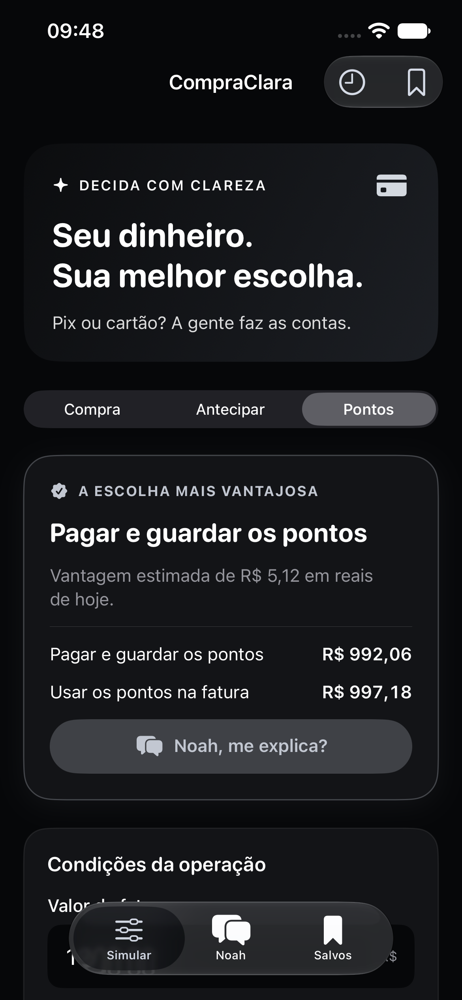

# CompraClara · projeto 60

Calculadora nativa para escolher entre Pix, cartão, antecipação e resgate de
pontos. Interface em português, visual preto e grafite e **Noah**, um chatbot
local que explica as contas de um jeito simples. Compatível com **iPhone 13**
(iOS 17+) e Mac (macOS 14+).



## Ver e instalar

- **Mac:** abra `CompraClara.xcodeproj`, escolha o esquema
  `CompraClara-macOS`, destino **My Mac**, e execute com ⌘R.
- **Simulador:** abra o mesmo projeto, escolha `CompraClara-iOS` e um iPhone
  simulado, e execute com ⌘R.
- **Seu iPhone 13:** conecte por cabo, escolha sua equipe em
  **Signing & Capabilities → Team**, selecione seu iPhone e execute com ⌘R.
  [Passo a passo completo](Docs/INSTALAR-NO-IPHONE.md).

Também pode dar dois cliques em `Abrir CompraClara.command`.
O projeto Xcode está incluído. XcodeGen só é necessário para regenerá-lo depois
que você mudar `project.yml`: `xcodegen generate`.

## O que tem

- **Simular:** Pix × cartão, quitação antecipada e uso de pontos na fatura.
- **Noah:** respostas prontas sobre o aplicativo e explicação da comparação
  atual, usando os valores reais da tela. Funciona sem internet, conta ou API.
- **Salvos:** até 100 simulações e rascunho no dispositivo; compartilhar resumo.
- Valores em reais, datas mensais, validação de entrada e memória de cálculo.
- Tema escuro, fontes escaláveis, rótulos acessíveis e teclado para números.

O Noah usa regras locais, sem modelo generativo: responde aos assuntos da
calculadora e informa seu limite em outras perguntas. A conversa fica em memória
na sessão; histórico de simulações e rascunho usam UserDefaults versionado.
Não existe sincronização entre iPhone e Mac.

## Premissas

Informe juros e taxas no total do cartão. Use rendimento líquido de 0% se o
dinheiro não ficar investido. Pontos, cashback e 0,8% a.m. são exemplos editáveis,
sem garantia de rendimento ou conversão. A comparação pressupõe dinheiro
reservado e pagamento integral da fatura. [Fórmulas](Docs/FORMULAS.md).

## Validar

```sh
swift test --package-path Packages/DecisionCore --scratch-path /tmp/compraclara-tests
python3 Scripts/check_math.py
xcodebuild -project CompraClara.xcodeproj -scheme CompraClara-iOS \
  -destination 'generic/platform=iOS Simulator' \
  -derivedDataPath /tmp/compraclara-build CODE_SIGNING_ALLOWED=NO build
```

Para testes de interface, selecione um simulador no Xcode e use ⌘U.
[Resultados e limites da validação](Docs/VALIDACAO.md).

## Arquivos principais

| Arquivo | Responsabilidade |
| --- | --- |
| `App/AppRootView.swift` | Estado compartilhado e abas |
| `App/CalculatorView.swift` | Entrada, resultado e detalhamento |
| `App/AssistantView.swift` | Conversa com o Noah |
| `App/InputState.swift` | Validação, rascunho e histórico |
| `Packages/DecisionCore` | Motor e chatbot testáveis sem SwiftUI |
| `App/Assets.xcassets` | Ícones iPhone/Mac |
| `UITests` | Fluxos reais no simulador |
| `.ai/PROJECT_MAP.md` | Mapa breve para manutenção |

O símbolo do ícone segue a referência do Inter, recolorido em cinza sobre preto
conforme pedido. [Fonte e reprodução do ícone](Design/LOGO.md).
Este é um projeto pessoal independente. Não conecta ao banco nem pede senha.
