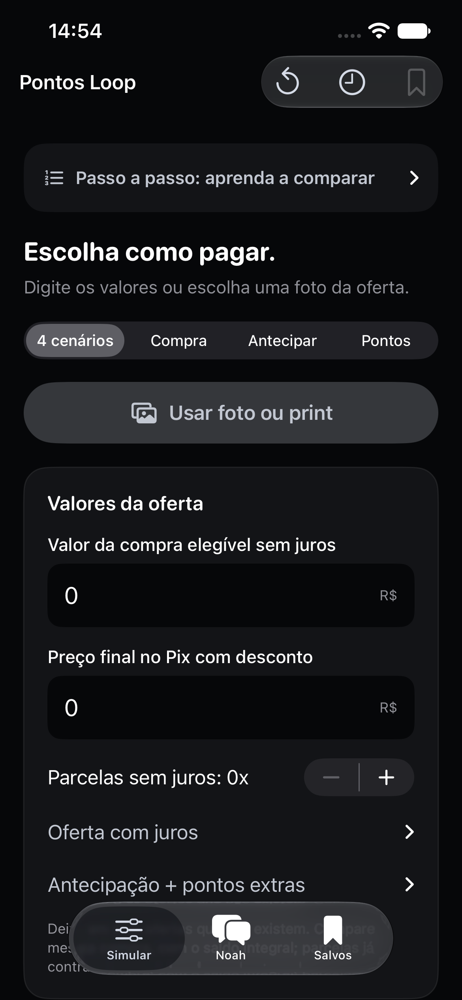

# Pontos Loop · projeto 60 (numeração apenas da pasta local)

Calculadora nativa para escolher entre Pix, cartão, antecipação e resgate de
pontos. Interface em português, visual preto e grafite e **Noah**, um chatbot
local que explica as contas de um jeito simples. Compatível com **iPhone 13**
(iOS 17+) e Mac (macOS 14+).




*Captura real no simulador iPhone 13, com os campos iniciais zerados.*

## Ver e instalar

- **Mac:** abra `PontosLoop.xcodeproj`, escolha o esquema
  `PontosLoop-macOS`, destino **My Mac**, e execute com ⌘R.
- **Simulador:** abra o mesmo projeto, escolha `PontosLoop-iOS` e um iPhone
  simulado, e execute com ⌘R.
- **Seu iPhone 13:** conecte por cabo, escolha sua equipe em
  **Signing & Capabilities → Team**, selecione seu iPhone e execute com ⌘R.
  [Passo a passo completo](Docs/INSTALAR-NO-IPHONE.md).

Também pode dar dois cliques em `Abrir Pontos Loop.command`.
O projeto Xcode está incluído. XcodeGen só é necessário para regenerá-lo depois
que você mudar `project.yml`: `xcodegen generate`.

## Aprender e comparar os quatro casos

No topo há **Passo a passo: aprenda a comparar**. Novas simulações começam com
valores numéricos zerados; **Nova simulação** limpa o rascunho atual sem apagar o histórico.

1. Informe o valor elegível da compra sem juros e o preço final no Pix.
2. Preencha as parcelas sem juros e, se existir, o total/parcelas da oferta com juros.
3. Copie a oferta de quitação e somente o bônus **extra** de pontos do Inter.
4. Nos ajustes, informe o valor real de 1.000 pontos no seu resgate, rendimento
   líquido e datas de disponibilidade dos pontos.
5. Toque em **Diagnosticar 4 cenários** ou peça o diagnóstico ao **Noah**.

Zero significa oferta não informada, não uma opção grátis. O app mostra os quatro
casos, aponta dados faltantes e recomenda apenas entre as ofertas válidas. Sem
valor de resgate informado, mostra pontos em quantidade e avisa que seu valor em
reais ainda não entra no ranking.

A estimativa Prime usa **1 ponto/R$ 2,50 de compra elegível**, nas opções de cartão
com e sem juros e na antecipação. Os pontos normais entram uma vez; antecipar soma
apenas o bônus extra informado. Juros não aumentam a base elegível. O modelo de
quatro ofertas compara a mesma compra antes da decisão; para dívida já contratada,
use **Antecipar**. Os prazos dos pontos são aproximações informadas pelo usuário.

**Só estar na fatura não torna todo lançamento elegível.** O Inter exige as
condições do Loop, débito automático ativo e pagamento integral em dia; encargos,
parcelamento da fatura e outros lançamentos são excluídos. Confira a previsão no
PDF da sua fatura. [Fontes oficiais e consulta](Docs/INTER-PRIME.md).

Para fotos, use **Usar foto ou print** (até 20 imagens). Confira Pix, total,
parcelas e se há juros antes de confirmar. Ofertas ambíguas e parcelas irregulares
exigem preenchimento manual. A leitura usa Apple Vision local; fotos e texto não
são gravados no histórico.

O **Noah não utiliza a IA do Mac**. Suas respostas locais usam o diagnóstico real
dos cenários informados, sem API ou modelo generativo.

## O que tem

- **Chat com mídia:** área de mensagem sem a borda nativa de foco, balões animados,
  sugestões em cartões deslizantes, até 20 anexos por mensagem, fotos/PDF/TXT e
  áudio de até 1 minuto com reprodução e transcrição local quando disponível.
  Confirme banco, total e parcelas para receber no chat o ranking de Inter Prime,
  Itaú, Mercado Livre e Pix. Antecipação exige a oferta real de quitação do Inter. [Como usar e limites](Docs/CHAT-MIDIA.md).
- **Simular:** Pix × cartão, quitação antecipada e uso de pontos na fatura.
- **Noah:** respostas prontas sobre o aplicativo e explicação da comparação
  atual, usando os valores reais da tela. Funciona sem internet, conta ou API.
- **Salvos:** até 100 simulações e rascunho no dispositivo; compartilhar resumo.
- Valores em reais, datas mensais, validação de entrada e memória de cálculo. Novas simulações começam sem rendimento ou recompensas; rascunhos antigos são preservados.
- Tema escuro, fontes escaláveis, rótulos acessíveis e teclado para números.

O Noah usa regras locais, sem modelo generativo: responde aos assuntos da
calculadora e informa seu limite em outras perguntas. A conversa fica em memória
na sessão; histórico de simulações e rascunho usam UserDefaults versionado.
Não existe sincronização entre iPhone e Mac.

## Atualizar pelo Mac

O atualizador gratuito verifica novos commits da main a cada 5 minutos, compila e
instala quando o iPhone está disponível e o Pontos Loop foi fechado. Configuração
local pelo Xcode; nenhum dado financeiro vai para o GitHub.
[Configuração, condições e como desligar](Docs/ATUALIZACOES.md).

## Premissas

Informe juros e taxas no total do cartão. Use rendimento líquido de 0% se o
dinheiro não ficar investido. Pontos, cashback e 0,8% a.m. são exemplos editáveis,
sem garantia de rendimento ou conversão. A comparação pressupõe dinheiro
reservado e pagamento integral da fatura. [Fórmulas](Docs/FORMULAS.md).

## Validar

```sh
swift test --package-path Packages/DecisionCore --scratch-path /tmp/compraclara-tests
python3 Scripts/check_math.py
xcodebuild -project PontosLoop.xcodeproj -scheme PontosLoop-iOS \
  -destination 'generic/platform=iOS Simulator' \
  -derivedDataPath /tmp/compraclara-build CODE_SIGNING_ALLOWED=NO build
```

Para testes de interface, selecione um simulador no Xcode e use ⌘U.
[Resultados e limites da validação](Docs/VALIDACAO.md).

## Arquivos principais

| Arquivo | Responsabilidade |
| --- | --- |
| `App/AppRootView.swift` | Estado compartilhado e abas |
| `App/CalculatorView.swift` | Entrada, resultado e detalhamento |
| `App/AssistantView.swift` | Conversa com o Noah |
| `App/InputState.swift` | Validação, rascunho e histórico |
| `Packages/DecisionCore` | Motor e chatbot testáveis sem SwiftUI |
| `App/Assets.xcassets` | Ícones iPhone/Mac |
| `UITests` | Fluxos reais no simulador |
| `.ai/PROJECT_MAP.md` | Mapa breve para manutenção |

O símbolo do ícone segue a referência do Inter, recolorido em cinza sobre preto
conforme pedido. [Fonte e reprodução do ícone](Design/LOGO.md).
Esta é uma ferramenta pessoal independente, sem vínculo oficial com o Inter. Não conecta ao banco nem pede senha.
